# GenRe Attendance — Perancangan Database Lengkap (Supabase PostgreSQL)

Dokumentasi teknis arsitektur basis data untuk sistem presensi, manajemen penugasan, monitoring kinerja panitia, evaluasi berkriteria, dan penerbitan sertifikat resmi **Pemilihan Duta GenRe Kabupaten Buleleng**.

---

## Bagian 1 — Identitas Proyek

### 1.1 Profil Aplikasi
- **Nama Aplikasi**: **GenRe Attendance**
- **Instansi / Organisasi**: Forum Generasi Berencana (GenRe) Kabupaten Buleleng & Panitia Pemilihan Duta GenRe Kabupaten Buleleng.
- **Tujuan Sistem**:
  1. Mengelola data kepanitiaan multi-divisi secara terstruktur dan transparan.
  2. Mencatat presensi kegiatan berbasis QR Dinamis dan permohonan presensi manual yang dapat diaudit.
  3. Memantau distribusi penugasan kegiatan dan pengerjaan tugas mandiri divisi.
  4. Melakukan penilaian kinerja panitia yang objektif melalui kombinasi **Skor Sistem (Maks 40)** dan **Evaluasi Koordinator Bidang (Maks 60)**.
  5. Menentukan kelayakan dan mencatat registrasi penerbitan sertifikat kepanitiaan resmi.
  6. Menyediakan kanal sanggahan / klarifikasi resmi bagi panitia sebelum nilai disahkan.

### 1.2 Teknologi yang Digunakan
- **Frontend & Backend API**: Next.js App Router (TypeScript) dideploy di Vercel.
- **Database Engine**: PostgreSQL 15+ yang dikelola oleh **Supabase**.
- **Autentikasi**: Supabase Auth (penyimpanan kredensial terisolasi pada skema `auth.users`).
- **Keamanan Data**: Supabase Row Level Security (RLS) granular berbasis peran.
- **Penyimpanan Berkas**: Supabase Storage (Bucket privat `certificates` & `evidence`).
- **Standar Waktu**: PostgreSQL `timestamptz` disimpan dalam format UTC dan direpresentasikan pada aplikasi menggunakan zona waktu **`Asia/Makassar` (WITA, UTC+8)**.

### 1.3 Gambaran Arsitektur Sistem

```
┌────────────────────────────────────────────────────────────────────────┐
│                   Aplikasi Next.js (App Router)                        │
│          Panitia (~70 Anggota) | Koordinator Bidang | BPH (Admin)      │
└──────────────────┬─────────────────────────────────┬───────────────────┘
                   │ Client Anon Key (RLS Filtered)  │ Server Action (Service Role)
                   ▼                                 ▼
┌────────────────────────────────────────────────────────────────────────┐
│                  Supabase PostgreSQL Cloud Engine                      │
│                                                                        │
│   ┌───────────────────────────┐      ┌─────────────────────────────┐   │
│   │   Supabase Auth           │      │   Row Level Security        │   │
│   │   (auth.users)            │◀─────│   Policy Check:             │   │
│   └─────────────┬─────────────┘      │   is_admin(), is_coord()    │   │
│                 │ 1-to-1             └──────────────┬──────────────┘   │
│                 ▼                                   ▼                  │
│   ┌────────────────────────────────────────────────────────────────┐   │
│   │   21 Tabel Basis Data (UUID Primary Key, Strict FK Integrity)  │   │
│   │   • Periode & Divisi (organization_periods, fields)            │   │
│   │   • Panitia (profiles)                                         │   │
│   │   • Kegiatan & Penugasan (activities, activity_assignments)    │   │
│   │   • Presensi (attendance_sessions, attendances, manual_req)    │   │
│   │   • Tugas (tasks, task_assignments)                            │   │
│   │   • Evaluasi & Sertifikat (policies, criteria, reviews, certs) │   │
│   │   • Keamanan (audit_logs, notifications, assignment_history)   │   │
│   └────────────────────────────────┬───────────────────────────────┘   │
│                                    │                                   │
│                                    ▼                                   │
│   ┌────────────────────────────────────────────────────────────────┐   │
│   │   Database Procedures & Analytical Views                       │   │
│   │   • trigger_set_updated_at()                                   │   │
│   │   • trigger_validate_attendance_rules()                        │   │
│   │   • calculate_system_score() (40 Poin)                         │   │
│   │   • calculate_and_upsert_final_evaluation() (100 Poin)         │   │
│   │   • v_active_members, v_activity_attendance_summary, dll       │   │
│   └────────────────────────────────────────────────────────────────┘   │
└────────────────────────────────────────────────────────────────────────┘
```

---

## Bagian 2 — Daftar Seluruh Tabel

Sistem dirancang dengan **21 tabel** (17 tabel utama dan 4 tabel pendukung) yang ternormalisasi untuk menjamin integritas referensial dan performa query.

| No | Nama Tabel | Fungsi Tabel | Primary Key | Relasi Utama | Tingkat Akses Data |
|:--:|---|---|---|---|---|
| 1 | `organization_periods` | Menyimpan siklus kepanitiaan tahunan dan batas kelulusan sertifikat | `id` (UUID) | None | Terbaca publik panitia; Diubah Admin |
| 2 | `fields` | Menyimpan divisi / bidang kepanitiaan (Acara, Humas, Logistik, dll.) | `id` (UUID) | FK ke `organization_periods`, `profiles` | Terbaca panitia; Diubah Admin |
| 3 | `profiles` | Menyimpan profil panitia yang terikat 1-to-1 dengan Supabase Auth | `id` (UUID) | FK ke `auth.users`, `fields` | Terbaca panitia; Diubah mandiri & Admin |
| 4 | `activities` | Menyimpan agenda resmi panitia beserta jadwal dan jendela waktu presensi | `id` (UUID) | FK ke `organization_periods`, `profiles` | Terbaca panitia; Diubah Koordinator & Admin |
| 5 | `activity_fields` | Junction table many-to-many antara kegiatan dengan bidang penanggung jawab | `id` (UUID) | FK ke `activities`, `fields` | Terbaca panitia; Diubah Koordinator & Admin |
| 6 | `activity_assignments` | Menyimpan surat penugasan sah anggota pada kegiatan tertentu | `id` (UUID) | FK ke `activities`, `profiles` | Terbaca pemilik & Koordinator; Diubah Koordinator |
| 7 | `assignment_history` | Log riwayat perubahan penugasan (pembatalan/mutasi status) | `id` (UUID) | FK ke `activity_assignments`, `profiles` | Read-only Koordinator & Admin (Via Trigger) |
| 8 | `tasks` | Menyimpan definisi tugas mandiri operasional divisi | `id` (UUID) | FK ke `organization_periods`, `activities`, `fields` | Terbaca panitia; Diubah Koordinator & Admin |
| 9 | `task_assignments` | Menghubungkan tugas mandiri dengan panitia penanggung jawab | `id` (UUID) | FK ke `tasks`, `profiles` | Terbaca pemilik & Koordinator; Diupdate pemilik |
| 10 | `attendance_sessions` | Mengelola sesi presensi dinamis berbatas waktu per kegiatan | `id` (UUID) | FK ke `activities`, `profiles` | Terbaca panitia; Diubah Koordinator & Admin |
| 11 | `attendances` | Menyimpan rekaman presensi sah panitia (check-in & check-out) | `id` (UUID) | FK ke `activity_assignments`, `attendance_sessions` | Terbaca pemilik & Koordinator; Diisi pemilik via QR |
| 12 | `manual_attendance_requests` | Form pengajuan kehadiran manual dengan bukti kendala teknis | `id` (UUID) | FK ke `activity_assignments`, `attendances`, `profiles` | Terbaca pemilik & Koordinator; Diajukan pemilik |
| 13 | `evaluation_policies` | Master parameter bobot penilaian sistem (40) dan koordinator (60) | `id` (UUID) | FK ke `organization_periods`, `profiles` | Terbaca panitia; Diatur Admin |
| 14 | `evaluation_criteria` | Definisi 5 butir kriteria rubrik evaluasi koordinator (total 60 poin) | `id` (UUID) | FK ke `evaluation_policies` | Terbaca panitia; Diatur Admin |
| 15 | `performance_reviews` | Lembar penilaian kinerja anggota oleh koordinator bidang | `id` (UUID) | FK ke `organization_periods`, `profiles`, `policies` | Terbaca Koordinator & pemilik (saat approved) |
| 16 | `performance_scores` | Detail skor butir rubrik terbobot untuk transparansi penilaian | `id` (UUID) | FK ke `performance_reviews`, `criteria` | Terbaca Koordinator & pemilik (saat approved) |
| 17 | `final_evaluations` | Rekapitulasi nilai akhir (sistem + koordinator) & status kelayakan | `id` (UUID) | FK ke `organization_periods`, `profiles`, `policies` | Terbaca pemilik & Koordinator; Disahkan Admin |
| 18 | `certificates` | Pencatatan penerbitan nomor sertifikat resmi dan path berkas | `id` (UUID) | FK ke `final_evaluations`, `profiles` | Terbaca pemilik & Admin; Diterbitkan Admin |
| 19 | `clarification_requests` | Kanal sanggahan / klarifikasi nilai atau presensi sebelum disahkan | `id` (UUID) | FK ke `organization_periods`, `profiles`, `activities` | Terbaca pemilik & reviewer; Diajukan pemilik |
| 20 | `notifications` | Notifikasi in-app untuk penugasan, presensi, klarifikasi, & sertifikat | `id` (UUID) | FK ke `profiles` | Privat hanya untuk penerima |
| 21 | `audit_logs` | Jejak audit tidak dapat diubah (immutable) atas mutasi data sensitif | `id` (UUID) | FK ke `profiles` | Read-only Admin (Tercatat via DB Trigger) |

---

## Bagian 3 — Data Dictionary Lengkap

Setiap tabel di bawah ini didefinisikan secara identik dengan berkas migrasi SQL `supabase/migrations/20261012000001_initial_schema.sql`.

### 1. Tabel `organization_periods`
Menyimpan siklus periode kepanitiaan Pemilihan Duta GenRe Kabupaten Buleleng.

| Kolom | Tipe data | Nullable | Default | Key/Constraint | Fungsi |
|---|---|:---:|---|---|---|
| `id` | `uuid` | No | `gen_random_uuid()` | PK | Pengenal unik periode |
| `period_name` | `varchar(150)` | No | - | - | Nama periode (contoh: "Pemilihan Duta GenRe Buleleng 2026/2027") |
| `period_code` | `varchar(50)` | No | - | UNIQUE | Kode unik periode (contoh: "GENRE-BL-2026") |
| `start_date` | `date` | No | - | - | Tanggal mulai kepanitiaan |
| `end_date` | `date` | No | - | CHECK (`end_date >= start_date`) | Tanggal selesai kepanitiaan |
| `period_status` | `varchar(20)` | No | `'draft'` | CHECK IN (`'draft'`, `'active'`, `'completed'`, `'archived'`) | Status siklus periode |
| `certificate_threshold` | `numeric(5,2)` | No | `75.00` | CHECK (`>= 0 AND <= 100`) | Standar ambang nilai kelulusan sertifikat |
| `created_by` | `uuid` | Yes | `NULL` | FK -> `profiles(id)` ON DELETE SET NULL | Pengguna yang membuat periode |
| `created_at` | `timestamptz` | No | `clock_timestamp()` | - | Waktu pencatatan data ke sistem |
| `updated_at` | `timestamptz` | No | `clock_timestamp()` | - | Waktu pembaruan data terakhir |

---

### 2. Tabel `fields`
Menyimpan bidang atau divisi kepanitiaan (Acara, Humas, Logistik, Konsumsi, Kesekretariatan, BPH).

| Kolom | Tipe data | Nullable | Default | Key/Constraint | Fungsi |
|---|---|:---:|---|---|---|
| `id` | `uuid` | No | `gen_random_uuid()` | PK | Pengenal unik bidang |
| `period_id` | `uuid` | No | - | FK -> `organization_periods(id)` ON DELETE RESTRICT | Periode kepanitiaan tempat bidang bernaung |
| `field_name` | `varchar(100)` | No | - | - | Nama bidang (contoh: "Divisi Acara & Finalis") |
| `field_code` | `varchar(30)` | No | - | - | Kode divisi (contoh: "ACR", "HMS", "LOG") |
| `field_description` | `text` | Yes | `NULL` | - | Deskripsi tanggung jawab divisi |
| `coordinator_id` | `uuid` | Yes | `NULL` | FK -> `profiles(id)` ON DELETE SET NULL | Koordinator bidang bersangkutan |
| `field_status` | `varchar(20)` | No | `'active'` | CHECK IN (`'active'`, `'inactive'`) | Status keaktifan bidang |
| `created_at` | `timestamptz` | No | `clock_timestamp()` | - | Waktu data dibuat |
| `updated_at` | `timestamptz` | No | `clock_timestamp()` | - | Waktu data diperbarui |
| *Constraint* | - | - | - | UNIQUE (`period_id`, `field_code`) | Kode bidang tidak boleh ganda dalam 1 periode |

---

### 3. Tabel `profiles`
Menyimpan profil anggota kepanitiaan yang terhubung 1-to-1 dengan Supabase Auth.

| Kolom | Tipe data | Nullable | Default | Key/Constraint | Fungsi |
|---|---|:---:|---|---|---|
| `id` | `uuid` | No | - | PK, FK -> `auth.users(id)` ON DELETE RESTRICT | Terhubung langsung dengan akun Supabase Auth |
| `member_code` | `varchar(50)` | No | - | UNIQUE | Nomor induk panitia (contoh: "GENRE-007") |
| `full_name` | `varchar(255)` | No | - | - | Nama lengkap panitia beserta gelar jika ada |
| `email` | `varchar(255)` | No | - | UNIQUE | Alamat email resmi terverifikasi |
| `phone_number` | `varchar(30)` | Yes | `NULL` | - | Nomor WhatsApp/kontak panitia |
| `field_id` | `uuid` | Yes | `NULL` | FK -> `fields(id)` ON DELETE SET NULL | Bidang tempat panitia ditugaskan |
| `system_role` | `varchar(20)` | No | `'member'` | CHECK IN (`'admin'`, `'coordinator'`, `'member'`) | Hak akses sistem untuk evaluasi RLS |
| `organization_position` | `varchar(100)` | No | `'Anggota'` | - | Jabatan formal organisasi (Ketua, Koordinator, dll.) |
| `account_status` | `varchar(20)` | No | `'active'` | CHECK IN (`'active'`, `'inactive'`, `'suspended'`) | Status akun panitia |
| `joined_at` | `date` | No | `CURRENT_DATE` | - | Tanggal panitia resmi bergabung |
| `avatar_url` | `text` | Yes | `NULL` | - | URL foto profil dari storage bucket |
| `created_at` | `timestamptz` | No | `clock_timestamp()` | - | Waktu registrasi awal |
| `updated_at` | `timestamptz` | No | `clock_timestamp()` | - | Waktu pembaruan profil |

---

### 4. Tabel `activities`
Menyimpan agenda kegiatan kepanitiaan beserta pengaturan jendela check-in dan check-out.

| Kolom | Tipe data | Nullable | Default | Key/Constraint | Fungsi |
|---|---|:---:|---|---|---|
| `id` | `uuid` | No | `gen_random_uuid()` | PK | Pengenal unik kegiatan |
| `period_id` | `uuid` | No | - | FK -> `organization_periods(id)` ON DELETE RESTRICT | Periode kegiatan berlangsung |
| `activity_code` | `varchar(50)` | No | - | - | Kode unik kegiatan (contoh: "ACT-PLENO-1") |
| `activity_name` | `varchar(255)` | No | - | - | Nama kegiatan (contoh: "Gladi Bersih Grand Final") |
| `activity_description`| `text` | Yes | `NULL` | - | Detail agenda atau instruksi perlengkapan |
| `activity_location` | `varchar(255)` | No | - | - | Lokasi fisik pelaksanaan kegiatan |
| `start_at` | `timestamptz` | No | - | - | Waktu mulai kegiatan |
| `end_at` | `timestamptz` | No | - | CHECK (`end_at > start_at`) | Waktu berakhir kegiatan |
| `check_in_opens_at` | `timestamptz` | No | - | - | Waktu gerbang presensi masuk dibuka |
| `check_in_closes_at`| `timestamptz` | No | - | CHECK (`>= check_in_opens_at`) | Batas toleransi presensi masuk on-time |
| `check_out_opens_at`| `timestamptz` | No | - | CHECK (`>= check_in_opens_at`) | Waktu mulai diperbolehkan presensi pulang |
| `check_out_closes_at`| `timestamptz`| No | - | CHECK (`>= check_out_opens_at`) | Batas akhir presensi pulang ditutup |
| `activity_status` | `varchar(20)` | No | `'draft'` | CHECK IN (`'draft'`, `'scheduled'`, `'ongoing'`, `'completed'`, `'cancelled'`) | Siklus kegiatan |
| `attendance_required`| `boolean` | No | `true` | - | Penanda apakah kegiatan mewajibkan presensi |
| `created_by` | `uuid` | No | - | FK -> `profiles(id)` ON DELETE RESTRICT | Panitia pembuat kegiatan |
| `created_at` | `timestamptz` | No | `clock_timestamp()` | - | Waktu data dibuat |
| `updated_at` | `timestamptz` | No | `clock_timestamp()` | - | Waktu data diperbarui |
| *Constraint* | - | - | - | UNIQUE (`period_id`, `activity_code`) | Kode kegiatan tidak boleh ganda per periode |

---

### 5. Tabel `activity_fields`
Junction table many-to-many antara kegiatan dengan bidang penanggung jawab kegiatan.

| Kolom | Tipe data | Nullable | Default | Key/Constraint | Fungsi |
|---|---|:---:|---|---|---|
| `id` | `uuid` | No | `gen_random_uuid()` | PK | Pengenal relasi |
| `activity_id` | `uuid` | No | - | FK -> `activities(id)` ON DELETE CASCADE | Kegiatan yang bersangkutan |
| `field_id` | `uuid` | No | - | FK -> `fields(id)` ON DELETE RESTRICT | Bidang penanggung jawab |
| `notes` | `text` | Yes | `NULL` | - | Catatan penugasan khusus bidang |
| `created_at` | `timestamptz` | No | `clock_timestamp()` | - | Waktu penugasan bidang dicatat |
| *Constraint* | - | - | - | UNIQUE (`activity_id`, `field_id`) | Mencegah penugasan bidang ganda pada kegiatan sama |

---

### 6. Tabel `activity_assignments`
Mencatat penugasan panitia pada kegiatan tertentu sebagai basis kewajiban presensi sah.

| Kolom | Tipe data | Nullable | Default | Key/Constraint | Fungsi |
|---|---|:---:|---|---|---|
| `id` | `uuid` | No | `gen_random_uuid()` | PK | Pengenal penugasan |
| `activity_id` | `uuid` | No | - | FK -> `activities(id)` ON DELETE RESTRICT | Kegiatan yang wajib diikuti |
| `member_id` | `uuid` | No | - | FK -> `profiles(id)` ON DELETE RESTRICT | Anggota panitia yang ditugaskan |
| `assignment_type` | `varchar(30)` | No | `'attendance_required'` | CHECK IN (`'attendance_required'`, `'work_assignment'`, `'coordinator_duty'`, `'committee_support'`) | Jenis mandat penugasan |
| `assignment_description` | `text` | Yes | `NULL` | - | Catatan peran khusus saat kegiatan |
| `assignment_status` | `varchar(20)` | No | `'active'` | CHECK IN (`'active'`, `'cancelled'`, `'completed'`, `'excused'`) | Status keabsahan penugasan |
| `assigned_by` | `uuid` | No | - | FK -> `profiles(id)` ON DELETE RESTRICT | Pejabat penugasp (Ketua / Koordinator) |
| `assigned_at` | `timestamptz` | No | `clock_timestamp()` | - | Waktu mandat penugasan ditetapkan |
| `cancelled_at` | `timestamptz` | Yes | `NULL` | - | Waktu pembatalan penugasan jika dibatalkan |
| `cancellation_reason` | `text` | Yes | `NULL` | - | Alasan pembatalan mandat penugasan |
| `created_at` | `timestamptz` | No | `clock_timestamp()` | - | Waktu data dibuat |
| `updated_at` | `timestamptz` | No | `clock_timestamp()` | - | Waktu data diperbarui |
| *Constraint* | - | - | - | UNIQUE (`activity_id`, `member_id`) | Mencegah penugasan ganda pada anggota di 1 kegiatan |

---

### 7. Tabel `assignment_history`
Merekam jejak mutasi perubahan status penugasan kegiatan panitia.

| Kolom | Tipe data | Nullable | Default | Key/Constraint | Fungsi |
|---|---|:---:|---|---|---|
| `id` | `uuid` | No | `gen_random_uuid()` | PK | Pengenal riwayat |
| `activity_assignment_id` | `uuid` | No | - | FK -> `activity_assignments(id)` ON DELETE CASCADE | Penugasan yang mengalami mutasi |
| `previous_status` | `varchar(20)` | Yes | `NULL` | - | Status penugasan sebelum perubahan |
| `new_status` | `varchar(20)` | No | - | - | Status penugasan setelah perubahan |
| `action_by` | `uuid` | No | - | FK -> `profiles(id)` ON DELETE RESTRICT | Aktor yang mengubah status |
| `change_reason` | `text` | Yes | `NULL` | - | Keterangan alasan perubahan status |
| `created_at` | `timestamptz` | No | `clock_timestamp()` | - | Waktu mutasi terjadi (dicatat trigger) |

---

### 8. Tabel `tasks`
Menyimpan definisi tugas operasional divisi (terpisah dari penugasan individu).

| Kolom | Tipe data | Nullable | Default | Key/Constraint | Fungsi |
|---|---|:---:|---|---|---|
| `id` | `uuid` | No | `gen_random_uuid()` | PK | Pengenal unik tugas |
| `period_id` | `uuid` | No | - | FK -> `organization_periods(id)` ON DELETE RESTRICT | Periode tugas berlaku |
| `activity_id` | `uuid` | Yes | `NULL` | FK -> `activities(id)` ON DELETE SET NULL | Kegiatan terkait tugas jika relevan |
| `field_id` | `uuid` | Yes | `NULL` | FK -> `fields(id)` ON DELETE SET NULL | Divisi penanggung jawab tugas |
| `task_title` | `varchar(255)` | No | - | - | Judul tugas operasional |
| `task_description`| `text` | No | - | - | Rincian instruksi pengerjaan tugas |
| `priority` | `varchar(20)` | No | `'medium'` | CHECK IN (`'low'`, `'medium'`, `'high'`, `'urgent'`) | Tingkat urgensi pengerjaan tugas |
| `task_status` | `varchar(20)` | No | `'open'` | CHECK IN (`'open'`, `'in_progress'`, `'pending_review'`, `'completed'`, `'cancelled'`) | Status kemajuan tugas |
| `due_at` | `timestamptz` | Yes | `NULL` | - | Tenggat waktu pengumpulan tugas |
| `created_by` | `uuid` | No | - | FK -> `profiles(id)` ON DELETE RESTRICT | Pembuat definisi tugas |
| `created_at` | `timestamptz` | No | `clock_timestamp()` | - | Waktu pencatatan tugas |
| `updated_at` | `timestamptz` | No | `clock_timestamp()` | - | Waktu pembaruan tugas |

---

### 9. Tabel `task_assignments`
Menghubungkan tugas dengan anggota pelaksana dan mencatat status verifikasinya.

| Kolom | Tipe data | Nullable | Default | Key/Constraint | Fungsi |
|---|---|:---:|---|---|---|
| `id` | `uuid` | No | `gen_random_uuid()` | PK | Pengenal penugasan tugas |
| `task_id` | `uuid` | No | - | FK -> `tasks(id)` ON DELETE CASCADE | Tugas yang didelegasikan |
| `member_id` | `uuid` | No | - | FK -> `profiles(id)` ON DELETE RESTRICT | Panitia pelaksana tugas |
| `assigned_by` | `uuid` | No | - | FK -> `profiles(id)` ON DELETE RESTRICT | Pihak yang mendelegasikan tugas |
| `assigned_at` | `timestamptz` | No | `clock_timestamp()` | - | Waktu pendelegasian tugas |
| `assignment_status` | `varchar(20)` | No | `'assigned'` | CHECK IN (`'assigned'`, `'in_progress'`, `'submitted'`, `'completed'`, `'rejected'`, `'cancelled'`) | Status pengerjaan tugas panitia |
| `progress_note` | `text` | Yes | `NULL` | - | Catatan progres pengerjaan atau link tugas |
| `submitted_at` | `timestamptz` | Yes | `NULL` | - | Waktu panitia mengumpulkan tugas |
| `verified_by` | `uuid` | Yes | `NULL` | FK -> `profiles(id)` ON DELETE RESTRICT | Verifikator tugas (Koordinator) |
| `verified_at` | `timestamptz` | Yes | `NULL` | - | Waktu tugas disahkan selesai |
| `verification_note` | `text` | Yes | `NULL` | - | Umpan balik dari verifikator |
| `created_at` | `timestamptz` | No | `clock_timestamp()` | - | Waktu pencatatan penugasan |
| `updated_at` | `timestamptz` | No | `clock_timestamp()` | - | Waktu pembaruan penugasan |
| *Constraint* | - | - | - | UNIQUE (`task_id`, `member_id`) | Mencegah penugasan ganda anggota pada tugas sama |

---

### 10. Tabel `attendance_sessions`
Mengelola sesi presensi berbatas waktu untuk pengamanan presensi QR dinamis.

| Kolom | Tipe data | Nullable | Default | Key/Constraint | Fungsi |
|---|---|:---:|---|---|---|
| `id` | `uuid` | No | `gen_random_uuid()` | PK | Pengenal sesi presensi |
| `activity_id` | `uuid` | No | - | FK -> `activities(id)` ON DELETE CASCADE | Kegiatan yang menggelar sesi presensi |
| `session_name` | `varchar(100)` | No | - | - | Nama sesi (contoh: "Presensi Rapat Pagi") |
| `session_code` | `varchar(50)` | No | - | - | Kode sesi (contoh: "PLENO1-IN") |
| `session_status` | `varchar(20)` | No | `'closed'` | CHECK IN (`'scheduled'`, `'open'`, `'closed'`, `'cancelled'`) | Status aktif pembukaan sesi |
| `token_hash` | `varchar(128)` | Yes | `NULL` | - | HMAC-SHA256 hash token dinamis (bukan plain secret) |
| `token_expires_at`| `timestamptz` | Yes | `NULL` | - | Batas waktu kedaluwarsa token QR dinamis |
| `created_by` | `uuid` | No | - | FK -> `profiles(id)` ON DELETE RESTRICT | Operator pembuka sesi presensi |
| `created_at` | `timestamptz` | No | `clock_timestamp()` | - | Waktu pembuatan sesi |
| `updated_at` | `timestamptz` | No | `clock_timestamp()` | - | Waktu pembaruan sesi |
| *Constraint* | - | - | - | UNIQUE (`activity_id`, `session_code`) | Kode sesi unik per kegiatan |

---

### 11. Tabel `attendances`
Catatan presensi panitia yang sah berdasarkan penugasan kegiatan.

| Kolom | Tipe data | Nullable | Default | Key/Constraint | Fungsi |
|---|---|:---:|---|---|---|
| `id` | `uuid` | No | `gen_random_uuid()` | PK | Pengenal rekaman presensi |
| `activity_assignment_id` | `uuid` | No | - | FK -> `activity_assignments(id)` ON DELETE RESTRICT | Surat tugas dasar presensi |
| `attendance_session_id` | `uuid` | Yes | `NULL` | FK -> `attendance_sessions(id)` ON DELETE SET NULL | Sesi presensi saat check-in |
| `check_in_at` | `timestamptz` | Yes | `NULL` | - | Waktu aktual check-in tercatat |
| `check_out_at` | `timestamptz` | Yes | `NULL` | - | Waktu aktual check-out tercatat |
| `check_in_method` | `varchar(20)` | No | `'qr'` | CHECK IN (`'qr'`, `'manual'`, `'system'`) | Metode check-in |
| `check_out_method`| `varchar(20)` | Yes | `NULL` | CHECK IN (`'qr'`, `'manual'`, `'system'`) | Metode check-out |
| `check_in_status` | `varchar(30)` | No | `'pending_verification'` | CHECK IN (`'on_time'`, `'late'`, `'absent'`, `'excused'`, `'pending_verification'`) | Ketepatan waktu check-in |
| `check_out_status`| `varchar(30)` | Yes | `NULL` | CHECK IN (`'normal'`, `'early_departure'`, `'pending_verification'`) | Kondisi saat check-out |
| `verification_status` | `varchar(20)`| No | `'pending'` | CHECK IN (`'pending'`, `'approved'`, `'rejected'`) | Validitas keabsahan presensi |
| `verified_by` | `uuid` | Yes | `NULL` | FK -> `profiles(id)` ON DELETE RESTRICT | Petugas verifikasi presensi |
| `verified_at` | `timestamptz` | Yes | `NULL` | - | Waktu presensi diverifikasi |
| `attendance_note` | `text` | Yes | `NULL` | - | Catatan kehadiran jika manual/dispensasi |
| `created_at` | `timestamptz` | No | `clock_timestamp()` | - | Waktu data dibuat |
| `updated_at` | `timestamptz` | No | `clock_timestamp()` | - | Waktu data diperbarui |
| *Constraint 1* | - | - | - | UNIQUE (`activity_assignment_id`, `attendance_session_id`) | Mencegah presensi ganda pada sesi yang sama |
| *Constraint 2* | - | - | - | CHECK (`check_out_at IS NULL OR check_in_at IS NULL OR check_out_at >= check_in_at`) | Check-out dilarang mendahului check-in |

---

### 12. Tabel `manual_attendance_requests`
Form pengajuan presensi manual jika panitia terkendala kamera/koneksi saat memindai QR.

| Kolom | Tipe data | Nullable | Default | Key/Constraint | Fungsi |
|---|---|:---:|---|---|---|
| `id` | `uuid` | No | `gen_random_uuid()` | PK | Pengenal permohonan |
| `activity_assignment_id` | `uuid` | No | - | FK -> `activity_assignments(id)` ON DELETE RESTRICT | Penugasan yang dimohonkan presensinya |
| `attendance_id` | `uuid` | Yes | `NULL` | FK -> `attendances(id)` ON DELETE SET NULL | Tautan ke catatan presensi jika telah disetujui |
| `attendance_type`| `varchar(20)` | No | - | CHECK IN (`'check_in'`, `'check_out'`, `'both'`) | Jenis permohonan presensi |
| `claimed_event_time` | `timestamptz` | No | - | - | Waktu aktual anggota mengklaim hadir di lokasi |
| `recorded_at` | `timestamptz` | No | `clock_timestamp()` | - | Waktu pengajuan sistem dikirimkan |
| `reason` | `text` | No | - | - | Alasan kendala teknis / izin penugasan |
| `evidence_url` | `text` | Yes | `NULL` | - | URL foto bukti di lokasi kegiatan |
| `requested_by` | `uuid` | No | - | FK -> `profiles(id)` ON DELETE RESTRICT | Anggota pemohon |
| `review_status` | `varchar(20)` | No | `'pending'` | CHECK IN (`'pending'`, `'approved'`, `'rejected'`) | Keputusan koordinator atas permohonan |
| `reviewed_by` | `uuid` | Yes | `NULL` | FK -> `profiles(id)` ON DELETE RESTRICT | Koordinator yang memproses |
| `reviewed_at` | `timestamptz` | Yes | `NULL` | - | Waktu keputusan diambil |
| `review_note` | `text` | Yes | `NULL` | - | Catatan / justifikasi koordinator |
| `created_at` | `timestamptz` | No | `clock_timestamp()` | - | Waktu pembuatan pengajuan |
| `updated_at` | `timestamptz` | No | `clock_timestamp()` | - | Waktu pembaruan pengajuan |

---

### 13. Tabel `evaluation_policies`
Master parameter formula pembobotan nilai per periode kepanitiaan.

| Kolom | Tipe data | Nullable | Default | Key/Constraint | Fungsi |
|---|---|:---:|---|---|---|
| `id` | `uuid` | No | `gen_random_uuid()` | PK | Pengenal kebijakan |
| `period_id` | `uuid` | No | - | FK -> `organization_periods(id)` ON DELETE RESTRICT | Periode yang mengadopsi kebijakan |
| `policy_version` | `varchar(20)`| No | `'v1.0'` | - | Versi kebijakan perhitungan (contoh: "v1.0") |
| `attendance_weight` | `numeric(5,2)` | No | `20.00` | CHECK (`>= 0`) | Bobot kehadiran sistem (Maks 20 poin) |
| `punctuality_weight` | `numeric(5,2)` | No | `10.00` | CHECK (`>= 0`) | Bobot ketepatan waktu sistem (Maks 10 poin) |
| `task_completion_weight`| `numeric(5,2)`| No | `10.00` | CHECK (`>= 0`) | Bobot penyelesaian tugas sistem (Maks 10 poin) |
| `coordinator_evaluation_weight` | `numeric(5,2)` | No | `60.00` | CHECK (`= 60.00`) | Bobot penilaian koordinator bidang (Maks 60 poin) |
| `certificate_threshold` | `numeric(5,2)` | No | `75.00` | CHECK (`>= 0 AND <= 100`) | Ambang batas nilai sertifikat (skala 0-100) |
| `effective_from` | `date` | No | - | - | Tanggal mulai berlaku kebijakan |
| `effective_until` | `date` | Yes | `NULL` | - | Tanggal akhir berlaku kebijakan |
| `policy_status` | `varchar(20)` | No | `'active'` | CHECK IN (`'draft'`, `'active'`, `'archived'`) | Status keaktifan kebijakan |
| `created_by` | `uuid` | No | - | FK -> `profiles(id)` ON DELETE RESTRICT | Admin pembuat kebijakan |
| `created_at` | `timestamptz` | No | `clock_timestamp()` | - | Waktu penetapan kebijakan |
| `updated_at` | `timestamptz` | No | `clock_timestamp()` | - | Waktu pembaruan kebijakan |
| *Constraint 1* | - | - | - | UNIQUE (`period_id`, `policy_version`) | Versi kebijakan tidak boleh ganda per periode |
| *Constraint 2* | - | - | - | CHECK (`att + punc + task = 40.00`) | Memastikan total bobot komponen sistem tepat 40 poin |
| *Constraint 3* | - | - | - | CHECK (`total_weights = 100.00`) | Memastikan total kumulatif bobot tepat 100 poin |

---

### 14. Tabel `evaluation_criteria`
Menyimpan konfigurasi 5 butir kriteria rubrik evaluasi koordinator.

| Kolom | Tipe data | Nullable | Default | Key/Constraint | Fungsi |
|---|---|:---:|---|---|---|
| `id` | `uuid` | No | `gen_random_uuid()` | PK | Pengenal butir kriteria |
| `policy_id` | `uuid` | No | - | FK -> `evaluation_policies(id)` ON DELETE RESTRICT | Kebijakan induk kriteria |
| `criterion_code` | `varchar(30)`| No | - | - | Kode unik (contoh: "COMMUNICATION") |
| `criterion_name` | `varchar(100)`| No | - | - | Nama kriteria (contoh: "Komunikasi & Responsivitas") |
| `criterion_description` | `text` | No | - | - | Penjelasan dan rubrik standar penilaian |
| `maximum_rating` | `numeric(5,2)`| No | `5.00` | - | Nilai batas atas rating (skala 5.00) |
| `weight_points` | `numeric(5,2)`| No | - | CHECK (`> 0`) | Poin bobot maksimal (15, 15, 10, 10, 10) |
| `display_order` | `int` | No | `1` | - | Urutan penampilan di form penilaian |
| `created_at` | `timestamptz` | No | `clock_timestamp()` | - | Waktu pembuatan kriteria |
| *Constraint* | - | - | - | UNIQUE (`policy_id`, `criterion_code`) | Kode kriteria unik dalam 1 kebijakan |

---

### 15. Tabel `performance_reviews`
Menyimpan lembar evaluasi kinerja panitia oleh koordinator bidang.

| Kolom | Tipe data | Nullable | Default | Key/Constraint | Fungsi |
|---|---|:---:|---|---|---|
| `id` | `uuid` | No | `gen_random_uuid()` | PK | Pengenal evaluasi kinerja |
| `period_id` | `uuid` | No | - | FK -> `organization_periods(id)` ON DELETE RESTRICT | Periode penilaian |
| `member_id` | `uuid` | No | - | FK -> `profiles(id)` ON DELETE RESTRICT | Panitia yang dinilai |
| `reviewer_id` | `uuid` | No | - | FK -> `profiles(id)` ON DELETE RESTRICT | Koordinator penilai |
| `policy_id` | `uuid` | No | - | FK -> `evaluation_policies(id)` ON DELETE RESTRICT | Kebijakan acuan pembobotan |
| `review_status` | `varchar(25)`| No | `'draft'` | CHECK IN (`'draft'`, `'submitted'`, `'needs_clarification'`, `'approved'`, `'returned'`) | Siklus status penilaian |
| `communication_score` | `numeric(3,2)` | No | `0.00` | CHECK (`>= 0.00 AND <= 5.00`) | Nilai komunikasi (Skala 1 - 5) |
| `responsibility_score`| `numeric(3,2)` | No | `0.00` | CHECK (`>= 0.00 AND <= 5.00`) | Nilai komitmen (Skala 1 - 5) |
| `teamwork_score` | `numeric(3,2)` | No | `0.00` | CHECK (`>= 0.00 AND <= 5.00`) | Nilai kerja sama tim (Skala 1 - 5) |
| `initiative_score` | `numeric(3,2)` | No | `0.00` | CHECK (`>= 0.00 AND <= 5.00`) | Nilai inisiatif (Skala 1 - 5) |
| `professionalism_score`| `numeric(3,2)`| No | `0.00` | CHECK (`>= 0.00 AND <= 5.00`) | Nilai etika/sikap (Skala 1 - 5) |
| `total_weighted_score` | `numeric(5,2)` | No | `0.00` | CHECK (`>= 0.00 AND <= 60.00`) | Total nilai terbobot koordinator (Maks 60) |
| `evidence_note` | `text` | No | - | - | Catatan bukti nyata kinerja anggota |
| `submitted_at` | `timestamptz` | Yes | `NULL` | - | Waktu koordinator submit penilaian |
| `reviewed_by_admin` | `uuid` | Yes | `NULL` | FK -> `profiles(id)` ON DELETE RESTRICT | Admin peninjau |
| `reviewed_at` | `timestamptz` | Yes | `NULL` | - | Waktu ditinjau admin |
| `reviewer_feedback` | `text` | Yes | `NULL` | - | Masukan pengembangan diri untuk anggota |
| `created_at` | `timestamptz` | No | `clock_timestamp()` | - | Waktu pembuatan lembar penilaian |
| `updated_at` | `timestamptz` | No | `clock_timestamp()` | - | Waktu pembaruan lembar penilaian |
| *Constraint* | - | - | - | UNIQUE (`period_id`, `member_id`) | 1 anggota hanya memiliki 1 evaluasi resmi per periode |

---

### 16. Tabel `performance_scores`
Menyimpan rincian butir rubrik terbobot untuk transparansi penilaian koordinator.

| Kolom | Tipe data | Nullable | Default | Key/Constraint | Fungsi |
|---|---|:---:|---|---|---|
| `id` | `uuid` | No | `gen_random_uuid()` | PK | Pengenal butir penilaian |
| `performance_review_id` | `uuid` | No | - | FK -> `performance_reviews(id)` ON DELETE CASCADE | Lembar review induk |
| `criterion_id` | `uuid` | No | - | FK -> `evaluation_criteria(id)` ON DELETE RESTRICT | Butir kriteria acuan |
| `criterion_code` | `varchar(30)`| No | - | - | Kode kriteria (contoh: "COMMUNICATION") |
| `criterion_name` | `varchar(100)`| No | - | - | Nama kriteria |
| `score` | `numeric(3,2)` | No | - | CHECK (`>= 1.00 AND <= 5.00`) | Skor mentah yang diberikan (1.00 - 5.00) |
| `maximum_score` | `numeric(3,2)` | No | `5.00` | - | Skor maksimal |
| `weight_points` | `numeric(5,2)` | No | - | CHECK (`> 0`) | Poin bobot maksimal (contoh: 15.00) |
| `weighted_points`| `numeric(5,2)` | No | - | CHECK (`>= 0 AND <= weight_points`) | Poin terhitung yang diperoleh panitia |
| `evidence_note` | `text` | Yes | `NULL` | - | Bukti khusus pada kriteria terkait |
| `created_at` | `timestamptz` | No | `clock_timestamp()` | - | Waktu data dibuat |
| `updated_at` | `timestamptz` | No | `clock_timestamp()` | - | Waktu data diperbarui |
| *Constraint* | - | - | - | UNIQUE (`performance_review_id`, `criterion_id`) | 1 butir kriteria hanya ada 1 kali per lembar review |

---

### 17. Tabel `final_evaluations`
Rekapitulasi akhir kelayakan sertifikat panitia per periode (Sistem 40 + Koordinator 60 = 100).

| Kolom | Tipe data | Nullable | Default | Key/Constraint | Fungsi |
|---|---|:---:|---|---|---|
| `id` | `uuid` | No | `gen_random_uuid()` | PK | Pengenal rekap akhir |
| `period_id` | `uuid` | No | - | FK -> `organization_periods(id)` ON DELETE RESTRICT | Periode kepanitiaan |
| `member_id` | `uuid` | No | - | FK -> `profiles(id)` ON DELETE RESTRICT | Panitia yang dievaluasi |
| `policy_id` | `uuid` | No | - | FK -> `evaluation_policies(id)` ON DELETE RESTRICT | Kebijakan yang digunakan untuk formula |
| `attendance_points` | `numeric(5,2)`| No | `0.00` | CHECK (`>= 0.00 AND <= 20.00`) | Poin kehadiran (Maks 20 poin) |
| `punctuality_points`| `numeric(5,2)`| No | `0.00` | CHECK (`>= 0.00 AND <= 10.00`) | Poin ketepatan waktu (Maks 10 poin) |
| `task_completion_points` | `numeric(5,2)`| No | `0.00` | CHECK (`>= 0.00 AND <= 10.00`) | Poin penyelesaian tugas (Maks 10 poin) |
| `system_score` | `numeric(5,2)`| No | `0.00` | CHECK (`>= 0.00 AND <= 40.00`) | Subtotal skor sistem (Maks 40 poin) |
| `coordinator_score` | `numeric(5,2)`| No | `0.00` | CHECK (`>= 0.00 AND <= 60.00`) | Subtotal evaluasi koordinator (Maks 60 poin)|
| `final_score` | `numeric(5,2)`| No | `0.00` | CHECK (`>= 0.00 AND <= 100.00`)| Nilai akhir total (Maks 100 poin) |
| `evaluation_status` | `varchar(25)`| No | `'calculating'` | CHECK IN (`'calculating'`, `'pending_approval'`, `'approved'`, `'needs_revision'`, `'clarification_open'`) | Status pengesahan evaluasi |
| `certificate_eligibility_status` | `varchar(20)`| No | `'pending'` | CHECK IN (`'pending'`, `'eligible'`, `'ineligible'`) | Keputusan kelayakan sertifikat |
| `calculated_at` | `timestamptz` | No | `clock_timestamp()` | - | Waktu kalkulasi sistem dijalankan |
| `approved_by` | `uuid` | Yes | `NULL` | FK -> `profiles(id)` ON DELETE RESTRICT | Admin / Ketua Panitia yang mengesahkan |
| `approved_at` | `timestamptz` | Yes | `NULL` | - | Waktu pengesahan resmi |
| `approval_note` | `text` | Yes | `NULL` | - | Catatan penetapan predikat kelulusan |
| `created_at` | `timestamptz` | No | `clock_timestamp()` | - | Waktu pencatatan data |
| `updated_at` | `timestamptz` | No | `clock_timestamp()` | - | Waktu pembaruan data |
| *Constraint* | - | - | - | UNIQUE (`period_id`, `member_id`) | 1 hasil rekapitulasi final per panitia per periode |

---

### 18. Tabel `certificates`
Mencatat penerbitan nomor registrasi sertifikat kepanitiaan resmi.

| Kolom | Tipe data | Nullable | Default | Key/Constraint | Fungsi |
|---|---|:---:|---|---|---|
| `id` | `uuid` | No | `gen_random_uuid()` | PK | Pengenal sertifikat |
| `final_evaluation_id` | `uuid` | No | - | UNIQUE, FK -> `final_evaluations(id)` ON DELETE RESTRICT | Tautan ke pengesahan nilai akhir sah |
| `certificate_number` | `varchar(100)`| No | - | UNIQUE | Nomor registrasi surat (contoh: "018/GENRE-BL/SERT/PANITIA/V/2026") |
| `certificate_status` | `varchar(20)` | No | `'draft'` | CHECK IN (`'draft'`, `'issued'`, `'revoked'`) | Status keabsahan sertifikat |
| `issued_at` | `timestamptz` | Yes | `NULL` | - | Tanggal dan waktu sertifikat resmi diterbitkan |
| `issued_by` | `uuid` | Yes | `NULL` | FK -> `profiles(id)` ON DELETE RESTRICT | Pejabat penandatangan / penerbit |
| `file_path` | `text` | Yes | `NULL` | - | Path berkas di Supabase Storage bucket `certificates` |
| `created_at` | `timestamptz` | No | `clock_timestamp()` | - | Waktu data dibuat |
| `updated_at` | `timestamptz` | No | `clock_timestamp()` | - | Waktu data diperbarui |

---

### 19. Tabel `clarification_requests`
Mencatat permohonan sanggahan/klarifikasi panitia atas presensi, tugas, atau penilaian kinerja.

| Kolom | Tipe data | Nullable | Default | Key/Constraint | Fungsi |
|---|---|:---:|---|---|---|
| `id` | `uuid` | No | `gen_random_uuid()` | PK | Pengenal sanggahan |
| `period_id` | `uuid` | No | - | FK -> `organization_periods(id)` ON DELETE RESTRICT | Periode kepanitiaan |
| `member_id` | `uuid` | No | - | FK -> `profiles(id)` ON DELETE RESTRICT | Panitia yang mengajukan sanggahan |
| `related_activity_id` | `uuid` | Yes | `NULL` | FK -> `activities(id)` ON DELETE SET NULL | Kegiatan yang dipermasalahkan (jika ada) |
| `related_attendance_id`| `uuid`| Yes | `NULL` | FK -> `attendances(id)` ON DELETE SET NULL | Catatan presensi yang diklarifikasi |
| `related_review_id` | `uuid` | Yes | `NULL` | FK -> `performance_reviews(id)` ON DELETE SET NULL | Lembar evaluasi yang disanggah |
| `related_final_evaluation_id`|`uuid`| Yes | `NULL` | FK -> `final_evaluations(id)` ON DELETE SET NULL | Rekap akhir yang disanggah |
| `request_type` | `varchar(30)` | No | - | CHECK IN (`'attendance_dispute'`, `'task_dispute'`, `'evaluation_dispute'`, `'general_inquiry'`) | Kategori permohonan sanggahan |
| `request_description` | `text` | No | - | - | Kronologi sanggahan dan alasan sanggah |
| `request_status` | `varchar(20)` | No | `'submitted'` | CHECK IN (`'submitted'`, `'under_review'`, `'resolved'`, `'rejected'`) | Progres penanganan sanggahan |
| `assigned_reviewer_id` | `uuid` | Yes | `NULL` | FK -> `profiles(id)` ON DELETE RESTRICT | Pejabat pemeriksa sanggahan |
| `resolution_note` | `text` | Yes | `NULL` | - | Putusan akhir dan justifikasi penyelesaian |
| `resolved_by` | `uuid` | Yes | `NULL` | FK -> `profiles(id)` ON DELETE RESTRICT | Pejabat yang menyelesaikan sanggahan |
| `resolved_at` | `timestamptz` | Yes | `NULL` | - | Waktu sanggahan selesai diproses |
| `created_at` | `timestamptz` | No | `clock_timestamp()` | - | Waktu submit sanggahan |
| `updated_at` | `timestamptz` | No | `clock_timestamp()` | - | Waktu pembaruan sanggahan |

---

### 20. Tabel `notifications`
Menyimpan notifikasi dalam aplikasi bagi panitia mengenai agenda, tugas, dan sertifikat.

| Kolom | Tipe data | Nullable | Default | Key/Constraint | Fungsi |
|---|---|:---:|---|---|---|
| `id` | `uuid` | No | `gen_random_uuid()` | PK | Pengenal notifikasi |
| `user_id` | `uuid` | No | - | FK -> `profiles(id)` ON DELETE CASCADE | Panitia penerima notifikasi |
| `title` | `varchar(255)` | No | - | - | Judul notifikasi |
| `message` | `text` | No | - | - | Isi ringkas pesan notifikasi |
| `notification_type` | `varchar(50)` | No | `'general'` | CHECK IN (`'general'`, `'assignment'`, `'attendance'`, `'task'`, `'evaluation'`, `'certificate'`, `'clarification'`) | Kategori notifikasi |
| `action_url` | `text` | Yes | `NULL` | - | Rute navigasi halaman tujuan di website |
| `is_read` | `boolean` | No | `false` | - | Status sudah dibaca atau belum |
| `read_at` | `timestamptz` | Yes | `NULL` | - | Waktu notifikasi dibaca |
| `created_at` | `timestamptz` | No | `clock_timestamp()` | - | Waktu notifikasi diterbitkan |

---

### 21. Tabel `audit_logs`
Merekam jejak audit perubahan data sensitif secara permanen dan tidak dapat diubah (immutable).

| Kolom | Tipe data | Nullable | Default | Key/Constraint | Fungsi |
|---|---|:---:|---|---|---|
| `id` | `uuid` | No | `gen_random_uuid()` | PK | Pengenal entri log |
| `actor_id` | `uuid` | Yes | `NULL` | FK -> `profiles(id)` ON DELETE SET NULL | Pengguna yang melakukan tindakan |
| `action_type` | `varchar(50)` | No | - | - | Jenis operasi (`INSERT`, `UPDATE`, `ROLE_CHANGE`, dll.) |
| `entity_type` | `varchar(50)` | No | - | - | Nama tabel target entitas |
| `entity_id` | `uuid` | No | - | - | Primary key dari baris yang dimutasi |
| `old_values` | `jsonb` | Yes | `NULL` | - | Snapshot data sebelum diubah |
| `new_values` | `jsonb` | Yes | `NULL` | - | Snapshot data sesudah diubah |
| `reason` | `text` | Yes | `NULL` | - | Keterangan pemicu perubahan data |
| `ip_address` | `varchar(45)` | Yes | `NULL` | - | Alamat IP pemohon (opsional) |
| `created_at` | `timestamptz` | No | `clock_timestamp()` | - | Waktu mutasi terjadi secara presisi |

---

## Bagian 4 — Relasi dan ERD

Berikut adalah Entity Relationship Diagram (ERD) lengkap yang memodelkan relasi 21 tabel:

```mermaid
erDiagram
    organization_periods ||--o{ fields : "memiliki divisi"
    organization_periods ||--o{ activities : "menyelenggarakan"
    organization_periods ||--o{ tasks : "memiliki tugas"
    organization_periods ||--o{ evaluation_policies : "menerapkan formula"
    organization_periods ||--o{ performance_reviews : "memiliki evaluasi"
    organization_periods ||--o{ final_evaluations : "memiliki rekap nilai"
    organization_periods ||--o{ clarification_requests : "menampung sanggahan"

    fields ||--o{ profiles : "menempatkan anggota"
    fields ||--o{ tasks : "memiliki tugas divisi"
    fields ||--o{ activity_fields : "dilibatkan dalam kegiatan"

    profiles ||--o{ activity_assignments : "menerima penugasan"
    profiles ||--o{ task_assignments : "mengerjakan tugas"
    profiles ||--o{ performance_reviews : "dievaluasi"
    profiles ||--o{ final_evaluations : "memperoleh nilai akhir"
    profiles ||--o{ clarification_requests : "mengajukan sanggahan"
    profiles ||--o{ notifications : "menerima notifikasi"
    profiles ||--o{ audit_logs : "mencatat jejak tindakan"

    activities ||--o{ activity_fields : "melibatkan divisi"
    activities ||--o{ activity_assignments : "menugaskan anggota"
    activities ||--o{ attendance_sessions : "membuka sesi presensi"
    activities ||--o{ tasks : "terkait tugas lapangan"

    activity_assignments ||--o{ attendances : "dasar presensi sah"
    activity_assignments ||--o{ manual_attendance_requests : "dasar pengajuan manual"
    activity_assignments ||--o{ assignment_history : "merekam riwayat mutasi"

    attendance_sessions ||--o{ attendances : "memvalidasi sesi"

    tasks ||--o{ task_assignments : "didelegasikan ke anggota"

    evaluation_policies ||--o{ evaluation_criteria : "merinci 5 butir rubrik"
    evaluation_policies ||--o{ performance_reviews : "dasar pembobotan"
    evaluation_policies ||--o{ final_evaluations : "dasar kalkulasi akhir"

    performance_reviews ||--o{ performance_scores : "merinci skor per kriteria"
    performance_reviews ||--o{ clarification_requests : "dapat disanggah"

    final_evaluations ||--o| certificates : "menerbitkan sertifikat"
    final_evaluations ||--o{ clarification_requests : "dapat disanggah"
```



---

## Bagian 5 — Penjelasan Primary Key, Foreign Key, dan Constraint

### 5.1 Alasan Pemilihan Primary Key UUID v4
1. **Keamanan URL & Enumeration Attack Prevention**: Nilai integer berurutan (1, 2, 3) rentan terhadap scraping dan ID enumeration attack. UUID acak melindungi privasi berkas sertifikat dan token presensi.
2. **Kesesuaian dengan Supabase Auth**: `auth.users.id` bertipe `uuid`. Menggunakan UUID pada seluruh tabel memastikan integrasi foreign key yang konsisten.
3. **Desentralisasi ID**: Baris data dapat di-generate di client/server Next.js secara aman tanpa lock database.

### 5.2 Strategi Integritas Referensial & Penghapusan (`ON DELETE`)
1. **`ON DELETE RESTRICT` pada Data Historis**:
   - `profiles(id)` yang terikat ke `attendances`, `performance_reviews`, `final_evaluations`, `certificates`, dan `audit_logs` **DILARANG DIHAPUS (RESTRICT)**.
   - Jika panitia mengundurkan diri, akun diubah statusnya menjadi `account_status = 'inactive'`, bukan di-`DELETE`. Hal ini mencegah hilangnya data laporan masa lampau.
2. **`ON DELETE CASCADE` Hanya untuk Relasi Ketergantungan Kuat**:
   - Menghapus tugas (`tasks`) akan menghapus baris penugasan tugasnya (`task_assignments`).
   - Menghapus lembar review koordinator (`performance_reviews`) akan menghapus rincian skor butir kriteria (`performance_scores`).
3. **`ON DELETE SET NULL` untuk Relasi Opsional**:
   - `fields.coordinator_id` diatur ke `SET NULL` jika profil koordinator dinonaktifkan.

### 5.3 Constraint Proteksi Bisnis Unik
1. **Pencegahan Penugasan Ganda**: `UNIQUE (activity_id, member_id)` pada `activity_assignments` memastikan panitia hanya ditugaskan 1 kali pada kegiatan yang sama.
2. **Pencegahan Presensi Ganda**: `UNIQUE (activity_assignment_id, attendance_session_id)` pada `attendances` memastikan tidak terjadi dobel check-in pada sesi yang sama.
3. **Validasi Waktu Kronologis**:
   - `CHECK (end_at > start_at)` pada `activities`.
   - `CHECK (check_out_at >= check_in_at)` pada `attendances`.
4. **Validasi Bobot Nilai Terkunci**:
   - `CHECK (att + punc + task = 40.00)` dan `CHECK (coord = 60.00)` pada `evaluation_policies`.
   - `CHECK (final_score >= 0 AND final_score <= 100)` pada `final_evaluations`.

---

## Bagian 6 — Status dan Enum

### 6.1 Alasan Pemilihan `CHECK` Constraint Dibanding PostgreSQL `CREATE TYPE ... AS ENUM`
Pada proyek Supabase yang terintegrasi dengan Next.js, `CHECK (column IN (...))` dipilih karena:
1. **Kemudahan Migrasi Tanpa Table Lock**: Mengubah PostgreSQL `ENUM` memerlukan izin DDL khusus (`ALTER TYPE ADD VALUE`) dan tidak dapat menghapus nilai enum tanpa me-recreate tipe data. Sedangkan `CHECK` constraint sangat fleksibel diubah menggunakan `ALTER TABLE ... DROP CONSTRAINT / ADD CONSTRAINT`.
2. **Transparansi di Supabase Dashboard**: `CHECK` constraint langsung terdokumentasi pada skema tabel Supabase Studio.

### 6.2 State Machine & Aturan Transisi Status

```
Activities:
  [draft] ──▶ [scheduled] ──▶ [ongoing] ──▶ [completed]
                 │               │
                 └───────────────┴────────▶ [cancelled]

Task Assignments:
  [assigned] ──▶ [in_progress] ──▶ [submitted] ──▶ [completed]
                                       │
                                       └──▶ [rejected] ──▶ [in_progress]

Performance Reviews:
  [draft] ──▶ [submitted] ──▶ [approved]
                 │                 ▲
                 ├──▶ [returned] ──┘
                 │
                 └──▶ [needs_clarification] (jika anggota ajukan sanggahan)

Final Evaluations:
  [calculating] ──▶ [pending_approval] ──▶ [approved] (Resmi & Terbit Sertifikat)
        │
        └──▶ [clarification_open] (Terkunci jika ada sanggahan terbuka)
```

| Entitas | Status Nilai | Arti Status | Syarat / Pemicu Transisi |
|---|---|---|---|
| `organization_periods` | `draft` | Konfigurasi awal | Belum dipublikasikan |
| | `active` | Periode kepanitiaan berjalan | Ditetapkan oleh BPH / Admin |
| | `completed` | Agenda pemilihan selesai | Seluruh evaluasi telah disahkan |
| `activities` | `draft` | Konsep kegiatan | Rencana belum dijadwalkan |
| | `scheduled` | Kegiatan telah dijadwalkan | Notifikasi penugasan disiarkan ke anggota |
| | `ongoing` | Kegiatan sedang berlangsung | Gerbang check-in telah dibuka |
| | `completed` | Kegiatan selesai | Gerbang check-out ditutup |
| | `cancelled` | Kegiatan dibatalkan | Seluruh hak presensi dibatalkan otomatis |
| `activity_assignments` | `active` | Mandat penugasan berlaku sah | Anggota wajib hadir / bertugas |
| | `cancelled` | Penugasan ditarik | Dicatat ke `assignment_history` |
| | `excused` | Diberikan dispensasi izin | Tidak dipenalti dalam perhitungan presensi |
| `attendances` | `pending_verification`| Menunggu verifikasi petugas | Terjadi pada presensi manual |
| | `on_time` | Hadir tepat waktu | Check-in $\le$ `check_in_closes_at` |
| | `late` | Terlambat | Check-in $>$ `check_in_closes_at` |
| `clarification_requests`| `submitted` | Diajukan oleh anggota | Evaluasi akhir ditahan pada `clarification_open` |
| | `under_review` | Sedang diperiksa koordinator/admin | Telaah bukti dispensasi |
| | `resolved` | Permohonan disetujui | Nilai presensi/tugas diperbarui melalui server |
| | `rejected` | Permohonan ditolak | Nilai tetap pada catatan awal |

---

## Bagian 7 — Kebijakan Keamanan dan Row Level Security (RLS)

Seluruh 21 tabel **wajib mengaktifkan RLS (`ENABLE ROW LEVEL SECURITY`)**. Supabase PostgreSQL menegakkan keamanan di layer basis data sehingga kebocoran data di frontend tidak dapat menembus filter basis data.

### 7.1 Matriks Otorisasi Akses (RLS Matrix)

| Tabel | Role: `member` | Role: `coordinator` | Role: `admin` | Operasi Khusus Server |
|---|:---:|:---:|:---:|:---:|
| `profiles` | SELECT semua, UPDATE kontak sendiri | SELECT semua, UPDATE kontak sendiri | ALL (Kelola akun & role) | INSERT saat pendaftaran auth |
| `organization_periods` | SELECT | SELECT | ALL | - |
| `fields` | SELECT | SELECT | ALL | - |
| `activities` | SELECT | SELECT, INSERT, UPDATE | ALL | - |
| `activity_assignments` | SELECT penugasan sendiri | SELECT, INSERT, UPDATE | ALL | Trigger log ke `assignment_history` |
| `tasks` | SELECT | SELECT, INSERT, UPDATE | ALL | - |
| `task_assignments` | SELECT sendiri, UPDATE submit tugas | SELECT, INSERT, UPDATE, VERIFY | ALL | - |
| `attendance_sessions` | SELECT | ALL | ALL | Server validasi QR HMAC token |
| `attendances` | SELECT sendiri, INSERT check-in sendiri | SELECT semua, VERIFY | ALL | Trigger validasi toleransi waktu |
| `manual_attendance_requests` | SELECT sendiri, INSERT pengajuan sendiri| SELECT semua, UPDATE putusan | ALL | Server approval sinkron ke presensi |
| `evaluation_policies` | SELECT | SELECT | ALL | - |
| `evaluation_criteria` | SELECT | SELECT | ALL | - |
| `performance_reviews` | SELECT jika `review_status = 'approved'` | SELECT, INSERT, UPDATE divisi sendiri | ALL | Trigger sinkron total poin terbobot |
| `final_evaluations` | SELECT rekap nilai sendiri | SELECT semua divisi | ALL (Pengesahan resmi) | Fungsi `calculate_and_upsert` |
| `certificates` | SELECT sertifikat sendiri | SELECT semua | ALL (Penerbitan) | Server Storage URL signer |
| `clarification_requests` | SELECT sendiri, INSERT sanggahan sendiri| SELECT & VERIFY divisi sendiri | ALL | - |
| `audit_logs` | Dilarang (Akses ditolak) | Dilarang (Akses ditolak) | SELECT | Ditulis otomatis oleh DB Trigger |

### 7.2 Pencegahan Eskalasi Peran (*Privilege Escalation Prevention*)
Pada tabel `profiles`, kebijakan UPDATE memvalidasi agar anggota biasa tidak dapat mengubah `system_role` miliknya:
```sql
CREATE POLICY "profiles_update_self" ON profiles
    FOR UPDATE TO authenticated
    USING (id = auth.uid())
    WITH CHECK (
        id = auth.uid() AND
        system_role = (SELECT system_role FROM profiles WHERE id = auth.uid()) AND
        account_status = (SELECT account_status FROM profiles WHERE id = auth.uid())
    );
```
Perubahan `system_role` hanya dapat dieksekusi oleh Administrator aktif melalui fungsi helper `is_admin()`.

### 7.3 Pemblokiran Akun Nonaktif
Pengguna dengan `account_status != 'active'` diblokir dari seluruh fungsi mutasi data:
```sql
CREATE OR REPLACE FUNCTION is_admin() RETURNS BOOLEAN LANGUAGE sql STABLE SECURITY DEFINER
SET search_path = public, auth AS $$
    SELECT EXISTS (
        SELECT 1 FROM profiles 
        WHERE id = auth.uid() AND system_role = 'admin' AND account_status = 'active'
    );
$$;
```

---

## Bagian 8 — Contoh 25 Query SQL Siap Eksekusi

Seluruh 25 query berikut telah diuji dan terverifikasi **100% lolos eksekusi** pada test suite `scripts/test-queries.mjs`.

### 1. Mengambil semua anggota aktif
```sql
SELECT id, member_code, full_name, email, organization_position, system_role 
FROM profiles 
WHERE account_status = 'active' 
ORDER BY full_name ASC;
```

### 2. Mengambil anggota berdasarkan bidang
```sql
SELECT p.id, p.member_code, p.full_name, p.organization_position, f.field_name 
FROM profiles p 
JOIN fields f ON f.id = p.field_id 
WHERE p.field_id = '22222222-0000-0000-0000-000000000002' AND p.account_status = 'active';
```

### 3. Mengambil detail satu anggota
```sql
SELECT p.id, p.member_code, p.full_name, p.email, p.phone_number, 
       p.system_role, p.organization_position, p.account_status, p.joined_at, 
       f.field_name, coord.full_name AS coordinator_name 
FROM profiles p 
LEFT JOIN fields f ON f.id = p.field_id 
LEFT JOIN profiles coord ON coord.id = f.coordinator_id 
WHERE p.id = '11111111-0000-0000-0000-000000000007';
```

### 4. Mengambil daftar kegiatan dalam satu periode
```sql
SELECT id, activity_code, activity_name, activity_location, start_at, end_at, activity_status, attendance_required 
FROM activities 
WHERE period_id = '00000000-0000-0000-0000-000000000001' 
ORDER BY start_at ASC;
```

### 5. Mengambil anggota yang ditugaskan dalam kegiatan tertentu
```sql
SELECT aa.id AS assignment_id, p.id AS member_id, p.member_code, p.full_name, 
       f.field_name, aa.assignment_type, aa.assignment_status 
FROM activity_assignments aa 
JOIN profiles p ON p.id = aa.member_id 
LEFT JOIN fields f ON f.id = p.field_id 
WHERE aa.activity_id = '55555555-0000-0000-0000-000000000001' AND aa.assignment_status = 'active';
```

### 6. Mengambil anggota yang wajib hadir tetapi belum melakukan check-in
```sql
SELECT p.id, p.member_code, p.full_name, f.field_name, aa.assignment_type 
FROM activity_assignments aa 
JOIN profiles p ON p.id = aa.member_id 
LEFT JOIN fields f ON f.id = p.field_id 
LEFT JOIN attendances att ON att.activity_assignment_id = aa.id 
WHERE aa.activity_id = '55555555-0000-0000-0000-000000000001' 
  AND aa.assignment_status = 'active' 
  AND (att.id IS NULL OR att.check_in_at IS NULL);
```

### 7. Mengambil anggota yang sudah check-in tetapi belum check-out
```sql
SELECT p.id, p.member_code, p.full_name, att.check_in_at, att.check_in_status 
FROM attendances att 
JOIN activity_assignments aa ON aa.id = att.activity_assignment_id 
JOIN profiles p ON p.id = aa.member_id 
WHERE aa.activity_id = '55555555-0000-0000-0000-000000000001' 
  AND att.check_in_at IS NOT NULL 
  AND att.check_out_at IS NULL;
```

### 8. Mengambil rekap presensi per kegiatan
```sql
SELECT a.id, a.activity_code, a.activity_name, 
       COUNT(aa.id) AS total_assigned, 
       COUNT(CASE WHEN att.check_in_at IS NOT NULL THEN 1 END) AS total_checked_in, 
       COUNT(CASE WHEN att.check_in_status = 'on_time' THEN 1 END) AS total_on_time, 
       COUNT(CASE WHEN att.check_in_status = 'late' THEN 1 END) AS total_late 
FROM activities a 
LEFT JOIN activity_assignments aa ON aa.activity_id = a.id AND aa.assignment_status = 'active' 
LEFT JOIN attendances att ON att.activity_assignment_id = aa.id 
WHERE a.id = '55555555-0000-0000-0000-000000000001' 
GROUP BY a.id, a.activity_code, a.activity_name;
```

### 9. Mengambil riwayat presensi seorang anggota
```sql
SELECT act.activity_code, act.activity_name, act.start_at, 
       att.check_in_at, att.check_out_at, att.check_in_status, att.verification_status 
FROM attendances att 
JOIN activity_assignments aa ON aa.id = att.activity_assignment_id 
JOIN activities act ON act.id = aa.activity_id 
WHERE aa.member_id = '11111111-0000-0000-0000-000000000007' 
ORDER BY act.start_at DESC;
```

### 10. Mengambil tugas anggota yang belum selesai
```sql
SELECT t.id, t.task_title, t.priority, t.due_at, ta.assignment_status 
FROM task_assignments ta 
JOIN tasks t ON t.id = ta.task_id 
WHERE ta.member_id = '11111111-0000-0000-0000-000000000007' 
  AND ta.assignment_status NOT IN ('completed', 'cancelled');
```

### 11. Mengambil tugas yang melewati tenggat
```sql
SELECT t.id, t.task_title, t.due_at, t.task_status, p.full_name AS assigned_to 
FROM tasks t 
LEFT JOIN task_assignments ta ON ta.task_id = t.id 
LEFT JOIN profiles p ON p.id = ta.member_id 
WHERE t.period_id = '00000000-0000-0000-0000-000000000001' 
  AND t.due_at < clock_timestamp() 
  AND t.task_status NOT IN ('completed', 'cancelled');
```

### 12. Mengambil evaluasi anggota beserta skor per kriteria
```sql
SELECT pr.id, p.full_name AS member_name, rev.full_name AS reviewer_name, 
       pr.total_weighted_score, ps.criterion_name, ps.score, ps.weighted_points 
FROM performance_reviews pr 
JOIN profiles p ON p.id = pr.member_id 
JOIN profiles rev ON rev.id = pr.reviewer_id 
LEFT JOIN performance_scores ps ON ps.performance_review_id = pr.id 
WHERE pr.member_id = '11111111-0000-0000-0000-000000000007' 
  AND pr.period_id = '00000000-0000-0000-0000-000000000001';
```

### 13. Menghitung skor berbasis sistem maksimal 40 poin
```sql
WITH att_stat AS (
    SELECT 
        COUNT(aa.id) AS total_assigned, 
        COUNT(CASE WHEN att.verification_status = 'approved' AND att.check_in_at IS NOT NULL THEN 1 END) AS total_present, 
        COUNT(CASE WHEN att.check_in_status = 'on_time' THEN 1 END) AS total_ontime 
    FROM activity_assignments aa 
    JOIN activities act ON act.id = aa.activity_id 
    LEFT JOIN attendances att ON att.activity_assignment_id = aa.id 
    WHERE aa.member_id = '11111111-0000-0000-0000-000000000007' 
      AND act.period_id = '00000000-0000-0000-0000-000000000001' 
), task_stat AS (
    SELECT 
        COUNT(ta.id) AS total_tasks, 
        COUNT(CASE WHEN ta.assignment_status = 'completed' THEN 1 END) AS total_completed 
    FROM task_assignments ta 
    JOIN tasks t ON t.id = ta.task_id 
    WHERE ta.member_id = '11111111-0000-0000-0000-000000000007' 
      AND t.period_id = '00000000-0000-0000-0000-000000000001' 
)
SELECT 
    ROUND(((a.total_present::numeric / CASE WHEN a.total_assigned = 0 THEN 1 ELSE a.total_assigned END::numeric) * 20.0)::numeric, 2) AS attendance_points, 
    ROUND(((a.total_ontime::numeric / CASE WHEN a.total_present = 0 THEN 1 ELSE a.total_present END::numeric) * 10.0)::numeric, 2) AS punctuality_points, 
    ROUND(((t.total_completed::numeric / CASE WHEN t.total_tasks = 0 THEN 1 ELSE t.total_tasks END::numeric) * 10.0)::numeric, 2) AS task_points, 
    ROUND((
        (CASE WHEN a.total_assigned = 0 THEN 20.0 ELSE (a.total_present::numeric / a.total_assigned::numeric) * 20.0 END) + 
        (CASE WHEN a.total_present = 0 THEN 0.0 ELSE (a.total_ontime::numeric / a.total_present::numeric) * 10.0 END) + 
        (CASE WHEN t.total_tasks = 0 THEN 10.0 ELSE (t.total_completed::numeric / t.total_tasks::numeric) * 10.0 END)
    )::numeric, 2) AS total_system_score 
FROM att_stat a, task_stat t;
```

### 14. Menghitung evaluasi koordinator maksimal 60 poin
```sql
SELECT pr.id, pr.member_id, 
       pr.communication_score, pr.responsibility_score, pr.teamwork_score, 
       pr.initiative_score, pr.professionalism_score, 
       ROUND((
           ((pr.communication_score / 5.0) * 15.0) + 
           ((pr.responsibility_score / 5.0) * 15.0) + 
           ((pr.teamwork_score / 5.0) * 10.0) + 
           ((pr.initiative_score / 5.0) * 10.0) + 
           ((pr.professionalism_score / 5.0) * 10.0)
       )::numeric, 2) AS calculated_coordinator_score, 
       pr.total_weighted_score 
FROM performance_reviews pr 
WHERE pr.member_id = '11111111-0000-0000-0000-000000000007' 
  AND pr.period_id = '00000000-0000-0000-0000-000000000001';
```

### 15. Menghitung nilai akhir maksimal 100 poin
```sql
SELECT fe.id, p.member_code, p.full_name, 
       fe.system_score, fe.coordinator_score, 
       (fe.system_score + fe.coordinator_score) AS calculated_final_score, 
       fe.final_score, fe.certificate_eligibility_status 
FROM final_evaluations fe 
JOIN profiles p ON p.id = fe.member_id 
WHERE fe.period_id = '00000000-0000-0000-0000-000000000001' 
  AND fe.member_id = '11111111-0000-0000-0000-000000000007';
```

### 16. Mengambil anggota yang sudah layak secara perhitungan tetapi belum disahkan
```sql
SELECT fe.id, p.member_code, p.full_name, fe.final_score, fe.evaluation_status 
FROM final_evaluations fe 
JOIN profiles p ON p.id = fe.member_id 
WHERE fe.period_id = '00000000-0000-0000-0000-000000000001' 
  AND fe.certificate_eligibility_status = 'eligible' 
  AND fe.evaluation_status != 'approved';
```

### 17. Mengambil anggota yang masih mempunyai klarifikasi terbuka
```sql
SELECT cr.id, p.member_code, p.full_name, cr.request_type, cr.request_status, cr.created_at 
FROM clarification_requests cr 
JOIN profiles p ON p.id = cr.member_id 
WHERE cr.period_id = '00000000-0000-0000-0000-000000000001' 
  AND cr.request_status IN ('submitted', 'under_review');
```

### 18. Mengambil rekap nilai per bidang
```sql
SELECT f.id, f.field_name, 
       COUNT(p.id) AS total_members, 
       ROUND(AVG(fe.system_score)::numeric, 2) AS avg_system_score, 
       ROUND(AVG(fe.coordinator_score)::numeric, 2) AS avg_coordinator_score, 
       ROUND(AVG(fe.final_score)::numeric, 2) AS avg_final_score 
FROM fields f 
JOIN profiles p ON p.field_id = f.id 
LEFT JOIN final_evaluations fe ON fe.member_id = p.id AND fe.period_id = f.period_id 
WHERE f.period_id = '00000000-0000-0000-0000-000000000001' 
GROUP BY f.id, f.field_name;
```

### 19. Mengambil jumlah anggota aktif per bidang
```sql
SELECT f.id, f.field_code, f.field_name, COUNT(p.id) AS active_member_count 
FROM fields f 
LEFT JOIN profiles p ON p.field_id = f.id AND p.account_status = 'active' 
WHERE f.period_id = '00000000-0000-0000-0000-000000000001' 
GROUP BY f.id, f.field_code, f.field_name 
ORDER BY active_member_count DESC;
```

### 20. Mengambil audit log untuk satu anggota
```sql
SELECT id, action_type, entity_type, entity_id, old_values, new_values, reason, created_at 
FROM audit_logs 
WHERE actor_id = '11111111-0000-0000-0000-000000000007' 
   OR entity_id = '11111111-0000-0000-0000-000000000007' 
ORDER BY created_at DESC;
```

### 21. Mengambil daftar sertifikat yang telah diterbitkan
```sql
SELECT c.certificate_number, p.member_code, p.full_name, fe.final_score, c.issued_at, c.file_path 
FROM certificates c 
JOIN final_evaluations fe ON fe.id = c.final_evaluation_id 
JOIN profiles p ON p.id = fe.member_id 
WHERE fe.period_id = '00000000-0000-0000-0000-000000000001' 
  AND c.certificate_status = 'issued' 
ORDER BY c.issued_at DESC;
```

### 22. Mengambil daftar kegiatan dengan jumlah penugasan dan presensi
```sql
SELECT a.id, a.activity_code, a.activity_name, a.start_at, 
       COALESCE(assign.total_assigned, 0) AS total_assignments, 
       COALESCE(att.total_attended, 0) AS total_attendances 
FROM activities a 
LEFT JOIN (
    SELECT activity_id, COUNT(*) AS total_assigned 
    FROM activity_assignments 
    WHERE assignment_status = 'active' 
    GROUP BY activity_id
) assign ON assign.activity_id = a.id 
LEFT JOIN (
    SELECT aa.activity_id, COUNT(*) AS total_attended 
    FROM attendances att 
    JOIN activity_assignments aa ON aa.id = att.activity_assignment_id 
    GROUP BY aa.activity_id
) att ON att.activity_id = a.id 
WHERE a.period_id = '00000000-0000-0000-0000-000000000001' 
ORDER BY a.start_at ASC;
```

### 23. Mengambil daftar anggota yang tidak ditugaskan dalam kegiatan tertentu
```sql
SELECT p.id, p.member_code, p.full_name, f.field_name 
FROM profiles p 
LEFT JOIN fields f ON f.id = p.field_id 
WHERE p.account_status = 'active' 
  AND p.id NOT IN (
      SELECT member_id 
      FROM activity_assignments 
      WHERE activity_id = '55555555-0000-0000-0000-000000000001' 
        AND assignment_status = 'active'
  ) 
ORDER BY p.full_name ASC;
```

### 24. Mengambil riwayat perubahan penugasan
```sql
SELECT ah.id, aa.activity_id, p.full_name AS member_name, 
       ah.previous_status, ah.new_status, actor.full_name AS changed_by, 
       ah.change_reason, ah.created_at 
FROM assignment_history ah 
JOIN activity_assignments aa ON aa.id = ah.activity_assignment_id 
JOIN profiles p ON p.id = aa.member_id 
JOIN profiles actor ON actor.id = ah.action_by 
ORDER BY ah.created_at DESC;
```

### 25. Mengambil anggota yang evaluasinya belum lengkap
```sql
SELECT p.id, p.member_code, p.full_name, f.field_name, 
       pr.review_status AS coordinator_review_status, 
       fe.evaluation_status AS final_evaluation_status 
FROM profiles p 
LEFT JOIN fields f ON f.id = p.field_id 
LEFT JOIN performance_reviews pr ON pr.member_id = p.id AND pr.period_id = '00000000-0000-0000-0000-000000000001' 
LEFT JOIN final_evaluations fe ON fe.member_id = p.id AND fe.period_id = '00000000-0000-0000-0000-000000000001' 
WHERE p.account_status = 'active' 
  AND (pr.id IS NULL OR pr.review_status != 'approved' OR fe.id IS NULL OR fe.evaluation_status != 'approved');
```

---

## Bagian 9 — View dan Fungsi Database

### 9.1 Analytical Views
Tersedia 4 Views siap pakai yang telah terpasang di `20261012000003_functions_and_views.sql`:
1. `v_active_members`: Menampilkan panitia aktif lengkap dengan jabatan, divisi, dan identitas koordinator bidangnya.
2. `v_activity_attendance_summary`: Menampilkan statistik kuantitatif kehadiran kegiatan (total ditugaskan, total hadir, tepat waktu, terlambat, belum hadir).
3. `v_member_score_recap`: Rekapitulasi nilai komprehensif (kehadiran, ketepatan waktu, tugas, nilai koordinator, nilai akhir, serta nomor sertifikat resmi).
4. `v_field_performance_overview`: Ringkasan agregasi nilai rata-rata per bidang untuk evaluasi performa kepanitiaan tahunan.

### 9.2 Database Procedures & Calculation Functions
1. `calculate_system_score(p_period_id UUID, p_member_id UUID)`:
   - **Tujuan**: Menghitung secara otomatis poin presensi (maks 20), ketepatan waktu (maks 10), dan tugas mandiri (maks 10).
   - **Output**: Record kuantitatif terbobot (Maks 40 Poin).
2. `calculate_and_upsert_final_evaluation(p_period_id UUID, p_member_id UUID)`:
   - **Tujuan**: Menggabungkan skor sistem dengan skor lembar review koordinator terverifikasi.
   - **Fitur Cerdas**: Otomatis mendeteksi keberadaan permohonan sanggahan (`clarification_requests`) terbuka. Jika terdapat sanggahan terbuka, status kelayakan sertifikat ditahan (`pending`) dan status evaluasi ditandai `clarification_open`.
3. `SECURITY DEFINER` dengan Proteksi Jalur:
   - Seluruh fungsi privilese tinggi menerapkan klausa `SET search_path = public, auth` untuk memitigasi serangan *search-path hijacking*.

---

## Bagian 10 — Migration dan Seed Data

### 10.1 Urutan File Migrasi
Struktur migrasi berada pada direktori `supabase/migrations/` dan wajib dijalankan berurutan:
1. `20261012000001_initial_schema.sql`: Pembuatan seluruh 21 tabel, primary key, check constraint, unique constraint, dan foreign key.
2. `20261012000002_indexes_and_triggers.sql`: Indeks komprehensif, universal trigger `updated_at`, trigger audit, dan validasi jam presensi.
3. `20261012000003_functions_and_views.sql`: Fungsi engine perhitungan nilai dan analytical views.
4. `20261012000004_row_level_security.sql`: Kebijakan RLS granular untuk masing-masing tabel.

### 10.2 Berkas Seed Data Uji Fiktif
Berkas `supabase/seed.sql` menyediakan dataset kepanitiaan fiktif yang realistis untuk Pemilihan Duta GenRe Kabupaten Buleleng:
- 1 Periode aktif: "Pemilihan Duta GenRe Kabupaten Buleleng 2026/2027" (`GENRE-BL-2026`).
- 6 Bidang kepanitiaan: BPH, Acara, Humas, Logistik, Konsumsi, Kesekretariatan.
- 12 Akun panitia dengan variasi peran: Admin (Ketua & Sekretaris), Koordinator Bidang, dan Anggota.
- 4 Kegiatan resmi: Rapat Pleno 1, Workshop Pembekalan Finalis, Gladi Bersih Grand Final, Malam Grand Final.
- Penugasan kegiatan, presensi on-time dan terlambat, tugas mandiri, lembar review koordinator, rekapitulasi nilai akhir, sertifikat terbit, sanggahan klarifikasi, serta audit log.

---

## Bagian 11 — Panduan Instalasi dan Penggunaan Database

### 11.1 Instalasi pada Supabase Cloud
1. Buat proyek baru di [Supabase Dashboard](https://supabase.com).
2. Buka menu **SQL Editor**.
3. Jalankan isi file migrasi secara berurutan:
   - Salin dan jalankan `supabase/migrations/20261012000001_initial_schema.sql`
   - Salin dan jalankan `supabase/migrations/20261012000002_indexes_and_triggers.sql`
   - Salin dan jalankan `supabase/migrations/20261012000003_functions_and_views.sql`
   - Salin dan jalankan `supabase/migrations/20261012000004_row_level_security.sql`
4. Untuk mengisi data uji fiktif, jalankan isi file `supabase/seed.sql`.

### 11.2 Instalasi pada Supabase CLI Lokal
```bash
# Inisialisasi Supabase lokal (memerlukan Docker Desktop)
npx supabase init

# Terapkan seluruh migrasi
npx supabase db reset
```

### 11.3 Konfigurasi Environment Variables di Next.js (`.env.local`)
```env
NEXT_PUBLIC_SUPABASE_URL=https://your-project-id.supabase.co
NEXT_PUBLIC_SUPABASE_ANON_KEY=eyJhbGciOiJIUzI1NiIsInR5cCI6IkpXVCJ9...
SUPABASE_SERVICE_ROLE_KEY=eyJhbGciOiJIUzI1NiIsInR5cCI6IkpXVCJ9...
```
> [!CAUTION]
> **SUPABASE_SERVICE_ROLE_KEY** hanya boleh digunakan pada Server Actions / API Routes backend tepercaya. Jangan pernah mengekspos kunci ini ke browser client!

### 11.4 Menjalankan Otomatisasi Uji Integritas Lokal
Repository telah dilengkapi script validasi bawaan:
```bash
# Validasi kelengkapan skema DDL & RLS
node scripts/verify-schema.mjs

# Uji 13 skenario constraint dan referential integrity
node scripts/test-database-execution.mjs

# Uji eksekusi 25 query SQL operasional
node scripts/test-queries.mjs
```

---

## Bagian 12 — Batasan dan Asumsi Desain

1. **Multi-Sesi Presensi per Kegiatan**:
   - Satu kegiatan diperbolehkan memiliki beberapa sesi presensi (contoh: Sesi Rapat Pagi & Sesi Rapat Sore) melalui tabel `attendance_sessions`.
   - Skor presensi kegiatan didasarkan pada penugasan kegiatan sah (`activity_assignments`), sehingga panitia yang hadir pada salah satu atau seluruh sesi terverifikasi dihitung hadir sah tanpa penggandaan nilai.
2. **Perlindungan Anggota Tidak Ditugaskan**:
   - Jika seorang panitia tidak menerima mandat penugasan pada suatu kegiatan atau tidak dibebani tugas mandiri divisi, rumus perhitungan **tidak memberikan penalti 0 poin**, melainkan memberikan nilai dasar proporsional penuh agar tidak terjadi ketidakadilan administratif.
3. **Penyelesaian Sanggahan Sebelum Pengesahan**:
   - Adanya sanggahan terbuka (`submitted` atau `under_review`) pada `clarification_requests` secara otomatis memblokir pengesahan sertifikat akhir (`certificate_eligibility_status` terkunci pada `pending`).
4. **Penerbitan Sertifikat Resmi**:
   - Sertifikat hanya dapat diterbitkan setelah status evaluasi disahkan (`approved`) oleh Ketua Panitia/Admin. Nomor sertifikat dikunci dengan constraint `UNIQUE`. Berkas PDF disimpan di Supabase Storage bucket privat dan diakses melalui Signed URL bertanda tangan server.
